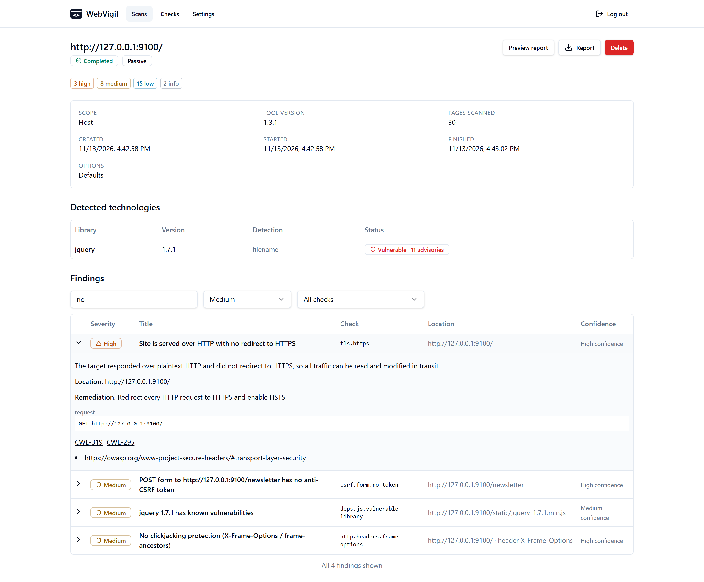
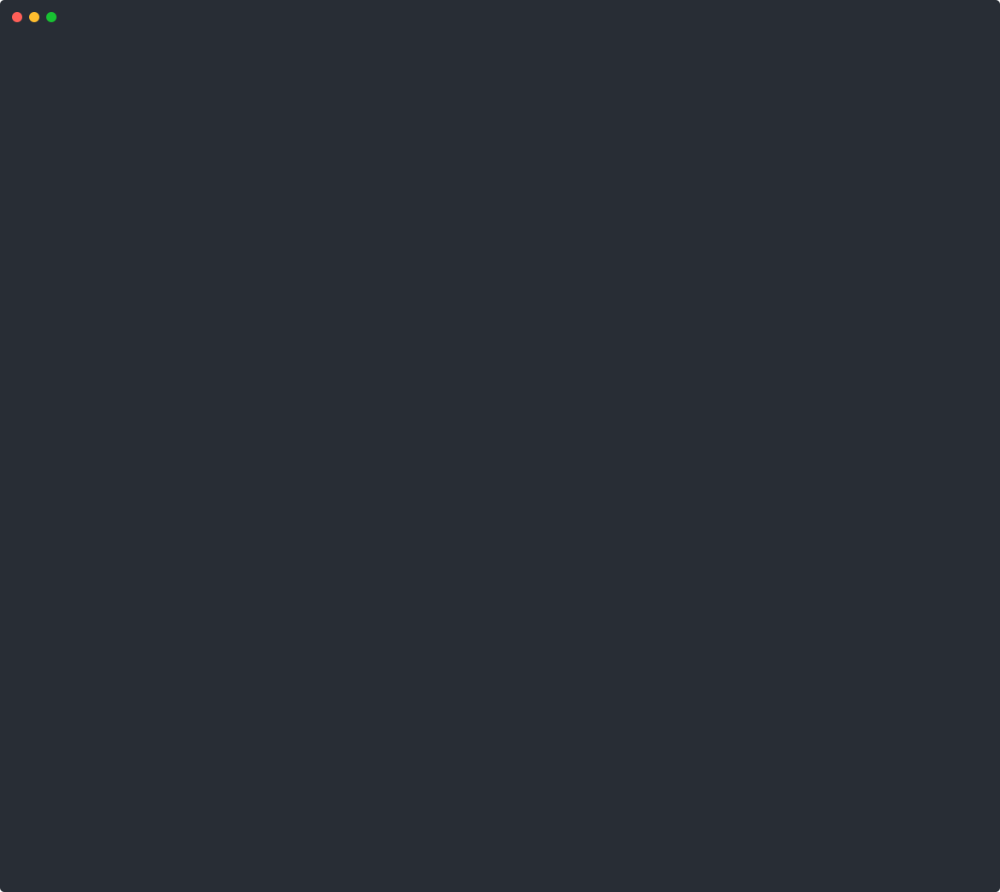

#  WebVigil

**English** · [Português (Brasil)](https://github.com/ryanvmorais/webvigil/blob/main/README.pt-BR.md)

<!-- The logo is an HTML  with an absolute URL: the PyPI rewrite in pyproject.toml covers only Markdown images. -->


[](https://github.com/ryanvmorais/webvigil/actions/workflows/ci.yml)
[](https://pypi.org/project/webvigil/)
[](https://github.com/ryanvmorais/webvigil/releases)
[](https://github.com/ryanvmorais/webvigil/pkgs/container/webvigil)


**WebVigil is an open-source web application vulnerability scanner (DAST) for developers.**
A Python engine and CLI that runs passive, production-safe checks by default and, behind an
explicit opt-in, an Active Mode for reflected and stored XSS, SQL injection, SSRF, command
injection, XXE, file upload and more, with every active finding confirmed against a baseline.
It writes JSON, SARIF 2.1.0, HTML and Markdown reports and fails a build with `--fail-on`,
so it fits CI.

It helps teams find and fix security problems in web apps, both **in development**
(terminal, CI, pre-deploy) and **in production** (non-intrusive checks that are safe to run
against live systems). WebVigil ships as a reusable **scan engine**, a **CLI**, and an
optional **web dashboard** built on top of the same engine.

> **Status:** released and maintained: [install it](#install). The CLI, the exit codes, the configuration keys, the check ids and the JSON report follow
> [Semantic Versioning](docs/stability.md); what each release changed is in the [changelog](CHANGELOG.md). [Scope and limitations](#scope-and-limitations) says what
> WebVigil deliberately does not do.



## WebVigil vs. other scanners

| | WebVigil | OWASP ZAP | Nuclei |
|---|---|---|---|
| Distribution | Library + CLI + optional dashboard | GUI + daemon (Docker/desktop) | CLI + YAML templates |
| Safe by default | Passive-only unless `--mode active` is explicit | Active scan is a common default workflow | Mostly read-only, template-dependent |
| Confirmed findings | Every active finding is proven against a per-request baseline | Signature + active-scan rules | Signature/template match |
| Best for | CI-native, in-band checks on your own app | Deep manual pentesting with a GUI/proxy | Fast sweeps against thousands of known CVE/misconfig templates |
| License | Apache-2.0 | Apache-2.0 | MIT |

WebVigil isn't a replacement for either — pair it with [Nuclei](https://github.com/projectdiscovery/nuclei)
for known-CVE template matching, or ZAP for manual, proxy-driven testing. See
[Scope and limitations](#scope-and-limitations) for the full boundary.

---

## What it checks

Passive checks run by default and are safe to point at production. Active Mode adds payload
injection and needs `--mode active` and `--authorized-by`. A switch in the last column turns on
something that is off until you name it ([all ten switches](#the-switches-that-are-off-by-default)).
`webvigil list-checks` prints every check id.


| Area | What it finds | Mode | Switch |
|---|---|---|---|
| Transport and headers | Missing security headers, technology-disclosure headers, cookie flags, TLS / HTTPS configuration, CORS misconfiguration, missing Subresource Integrity, mixed content ([docs](docs/content-checks.md)) | Passive | |
| Libraries | Client-side JavaScript libraries with known vulnerabilities, from a vendored Retire.js database, and optionally from OSV.dev ([docs](docs/dependency-fingerprinting.md)) | Passive | `--osv-online` |
| Information disclosure | Stack traces, directory listings, a session id in a URL, a private IP in a body; exposed `.git`, `.env`, backups and debug endpoints ([docs](docs/information-disclosure.md)) | Passive | `--probe` for the exposed files |
| Injection | Reflected XSS, SQL injection (error, boolean, time), path traversal, open redirect, OS command injection, template and expression-language injection, LDAP / XPath / SSI injection ([docs](docs/active-injection.md)) | Active | |
| Stored XSS | Persistent XSS, found by injecting a marker and crawling again ([docs](docs/active-injection.md#stored-xss----stored-xss-opt-in)) | Active | `--stored-xss` |
| SSRF | In-band: cloud metadata service, loopback and internal resources, `file://` ([docs](docs/active-injection.md#ssrf--cloud-metadata-loopback-file)) | Active | |
| Request envelope | CRLF / response splitting, host-header injection, risky HTTP methods, in-band XXE ([docs](docs/active-injection.md#request-envelope-injection)) | Active | `--xxe` for XXE |
| File upload | Unrestricted upload: a benign marker with a dangerous name or type, fetched back to prove execution, inline rendering or a path-traversal write ([docs](docs/active-injection.md#file-upload----file-upload-opt-in)) | Active | `--file-upload` |
| CSRF | A `POST` form without a token; a `GET` form that changes state. With the switch, each form is replayed cross-site and reported only if the server accepts it ([docs](docs/authenticated-scanning.md#active-csrf-confirmation----confirm-csrf-opt-in)) | Passive, then Active | `--confirm-csrf` |
| Sessions | Weak session ids, session fixation, a logout that does not invalidate the session. Findings name the cookie and never carry its value ([docs](docs/authenticated-scanning.md#session-security-checks)) | Passive, then Active | `--sample-sessions` `--test-logout` |
| Logged-in scans | A scan behind a login: a cookie, a header or bearer token, or, in Active Mode, a form login WebVigil performs itself ([docs](docs/authenticated-scanning.md)) | Any | `--cookie` `--header` `--login-url` |
| What gets scanned | The crawl and the injection pass seeded from an OpenAPI schema ([docs](docs/api-scanning.md)) or a HAR recording, for single-page apps ([docs](docs/har-import.md)); in Active Mode the crawler can also submit `POST` forms ([docs](docs/authenticated-scanning.md#post-forms----submit-post-forms-opt-in)) | Any | `--openapi` `--har` `--submit-post-forms` |

How it fared against OWASP DVWA (three security levels), Juice Shop and WebGoat, run on the
maintainer's own machine, is in [docs/benchmark.md](docs/benchmark.md): what it found, what it
missed and why. It is one person's measurement, nobody independent has counted it, and no other
scanner was run.

---

## Safe by default

WebVigil runs in **Safe Mode** by default: it only observes responses, headers, TLS
configuration, cookies, and page content. It never sends attack payloads and is safe to
point at production. The one request it adds beyond plain page fetches is a single GET
with an `Origin` header, used to detect reflective CORS — still a read-only GET, still
restricted to the target scope.

**Active Mode** (payload injection: XSS, SQLi, SSRF, etc.) is opt-in, requires an explicit
authorization flag, and is intended for development and staging environments only.

### The switches that are off by default

| Switch | What it does | Touches the target |
|---|---|---|
| `--probe` | Asks for sensitive paths: `.git`, `.env`, backups, debug endpoints | Reads only |
| `--stored-xss` | Injects a marker and crawls again to find it | **Writes** |
| `--file-upload` | Uploads a benign marker file | **Writes** |
| `--confirm-csrf` | Submits each state-changing form, then replays it cross-site | **Writes** |
| `--submit-post-forms` | The crawler submits `POST` forms and `--openapi` `POST` operations | **Writes** |
| `--xxe` | Re-types `POST` bodies as XML | Sends XML bodies |
| `--osv-online` | Looks libraries up on `api.osv.dev` | Sends library names out |
| `--login-url` | Logs in once with the account you give (Active Mode only) | Creates a session |
| `--sample-sessions` | A few cookie-less `GET`s of the entry URL | Reads only |
| `--test-logout` | Ends the scan's own session (Active Mode only) | Ends a session |

Everything else only reads.

---

## Responsible use

A scanner sends requests to a system, so who may point it where matters as much as what it
finds.

- **Authorized targets only.** Scan systems you own or have explicit permission to test.
  Scanning someone else's system without permission may be illegal where you live, and
  downloading this tool is not that permission.
- **Active Mode has a gate.** It needs `--mode active` **and** `--authorized-by "<who /
  engagement>"`; without the name WebVigil refuses (exit code `5`), and the name is written
  into the report.
- **Anything that writes, logs in or phones out is off by default**, each behind its own
  switch: `--stored-xss`, `--file-upload`, `--submit-post-forms` and `--confirm-csrf` write to
  the target; `--login-url` creates a session; `--osv-online` sends library names to OSV.dev.
- **Always on:** a scope guard that keeps every request on the target host, a request budget,
  a concurrency cap and a delay, and `robots.txt` is honoured unless you turn it off.
- **What WebVigil will not do:** brute-force credentials, evade a WAF or an IDS, keep access,
  take data out, or exploit beyond one bounded proof. That is not on the roadmap
  ([Scope and limitations](#scope-and-limitations)).
- **Demos stay on safe targets.** The screenshots, recordings and posts for this project scan
  the bundled test app (`scripts/serve-fixture-app.py`) or the maintainer's own systems,
  never a third party's.

Found a vulnerability **in WebVigil**? Report it privately, see [SECURITY.md](SECURITY.md).
Found one in someone else's system with it? Tell its owner, and follow their disclosure policy.

---

## Scope and limitations

WebVigil is deliberately bounded. It is an **in-band** scanner: the engine talks only to the
target, sends a small static set of payloads, and confirms every active finding against a
per-request baseline. That line keeps it fast, low-noise, and safe to distribute as a
open-source tool with no hosted service — at the cost of the classes below. For each, the thing
to reach for instead.

- **JavaScript-rendered apps.** The crawler parses HTML; it runs no headless browser, so a
  SPA that builds its DOM in JS exposes almost no surface to the crawl (the scan warns when
  the entry page looks like one). *Instead:* browse the app once with the network panel open,
  save the traffic as a HAR file and give it with `--har` ([docs](docs/har-import.md)), or point
  `--openapi` at the app's schema; either seeds the crawl and the injection pass directly.

- **Blind / out-of-band vulnerabilities.** Blind SSRF, blind command injection, blind /
  OOB XXE, blind stored XSS with no reflected marker, and HTTP request smuggling all need
  either a collaborator server the scanner hosts (public domain, DNS/HTTP listeners) or
  raw-socket control of request framing. Both cross the "engine talks only to the target"
  rule. *Instead:* pair WebVigil with your own collaborator — Burp Collaborator,
  [interactsh](https://github.com/projectdiscovery/interactsh). Background:
  [why blind SSRF is the one thing WebVigil won't do](docs/notes/why-not-oast.md).

- **Some active-scan classes.** `eval()` code
  injection, NoSQL injection, HTTP parameter pollution, remote file inclusion, DOM XSS,
  and verb-based auth bypass are out — each is either deferred, has no reliable in-band
  oracle, or needs a browser. The full table of what is covered and what is not, with the
  reason for each, is in
  [`docs/active-injection.md`](docs/active-injection.md#coverage-boundaries).

- **Authentication.** WebVigil authenticates with a **static** cookie (`--cookie`) or
  header (`--header`) you supply, or — in Active Mode — logs in to a **form** itself
  (`--login-url`) and re-logs in when the session drops. It does not drive CAPTCHA, MFA,
  an SSO / OAuth flow or a JSON token login. It checks session security (weak ids,
  fixation, a logout that does not invalidate) but never guesses an id. *Instead:* log in
  with your browser and paste the session cookie. See
  [authenticated scanning](docs/authenticated-scanning.md).

- **Not a template scanner.** There is no Nuclei-style CVE-template database, no CMS or
  plugin enumeration, no exploit matching beyond the vendored Retire.js data and the
  opt-in OSV.dev lookup. *Instead:* run [Nuclei](https://github.com/projectdiscovery/nuclei)
  alongside it.

- **Not a fuzzer.** Payloads are a small, documented, in-repository set with no mutation
  engine and no WAF-evasion tuning; WebVigil tests the parameters a target actually
  exposes, not guessed ones. *Instead:* a dedicated fuzzer (ffuf, wfuzz) for parameter
  mining and brute force.

- **Not an exploitation framework.** A confirmed SQLi is proved with one bounded marker,
  not by dumping the database; a confirmed traversal reads one known file, not the whole
  disk. WebVigil stops at proof.

- **API-scanning edges.** `--openapi` reads **JSON** only (convert a YAML document first)
  and fuzzes query / path / form-urlencoded-body parameters — not individual fields of a
  JSON request body. These are current limits, not permanent ones.
  See [API scanning](docs/api-scanning.md).

---

## Install

Python 3.12 or newer. The package has the engine and the CLI; the dashboard and the bundled
test app live in this repository only.

```bash
# Install it (or: uv tool install webvigil, or: pip install webvigil)
pipx install webvigil

# Check that it runs
webvigil version

# or, without installing Python packages:
docker run --rm ghcr.io/ryanvmorais/webvigil scan https://your-app.example

# keep a report: with --format it goes to stdout, so redirect it on the host
docker run --rm ghcr.io/ryanvmorais/webvigil scan https://your-app.example \
  --format html > report.html

# re-render a saved scan: mount the folder that holds it
docker run --rm -v "$PWD:/work" ghcr.io/ryanvmorais/webvigil \
  report /work/scan.json --format html > report.html
```

The image is built for `linux/amd64` and `linux/arm64` and carries signed build provenance and
an SBOM (see [releasing](docs/releasing.md#every-release)). `webvigil[web]` adds the Web API.

## Quick start

> The steps below run from a clone of this repository, because the test app ships with it, and
> need [uv](https://docs.astral.sh/uv/). `your-app.example` stands for **a system you own or
> may test**: replace it. With the package installed, drop the `uv run`.

Try it first on a target built to be attacked, on your own machine: a test app that ships with
this repository, or [OWASP Juice Shop](https://github.com/juice-shop/juice-shop) or
[DVWA](https://github.com/digininja/DVWA) on `localhost`.

```bash
# Clone the repository
git clone https://github.com/ryanvmorais/webvigil && cd webvigil

# The test app needs the web extra
uv sync --all-extras

# An intentionally vulnerable app on 127.0.0.1:9100
uv run python scripts/serve-fixture-app.py &

# Scan it in Active Mode (about 2 minutes: it has slow, time-based cases)
uv run webvigil scan http://127.0.0.1:9100 --mode active --authorized-by "trying WebVigil"
```

Then on your own app:

```bash
# A passive scan, the safe default
uv run webvigil scan https://your-app.example

# The same scan, written to an HTML report
uv run webvigil scan https://your-app.example --format html --output report.html

# Also probe for exposed .git/.env/backups
uv run webvigil scan https://your-app.example --probe

# Active Mode: injection + in-band SSRF testing
uv run webvigil scan https://your-app.example --mode active --authorized-by "you / engagement"

# + stored XSS (writes markers)
uv run webvigil scan https://your-app.example --mode active --authorized-by me --stored-xss

# + file-upload testing (writes files)
uv run webvigil scan https://your-app.example --mode active --authorized-by me --file-upload

# + the crawler submits POST forms (writes)
uv run webvigil scan https://your-app.example --mode active --authorized-by me \
  --submit-post-forms

# + CSRF confirmation (submits forms)
uv run webvigil scan https://your-app.example --mode active --authorized-by me \
  --cookie "session=<paste>" --confirm-csrf

# An authenticated scan, with the session cookie from your browser
uv run webvigil scan https://your-app.example --cookie "session=<paste from your browser>"

# Log in by itself
WEBVIGIL_LOGIN_PASSWORD=... uv run webvigil scan https://your-app.example \
  --mode active --authorized-by me \
  --login-url https://your-app.example/signin --username scanner@example.com

# Also judge fresh anonymous session ids (GET-only)
uv run webvigil scan https://your-app.example --sample-sessions

# + logout test (ends the scan's own session)
WEBVIGIL_LOGIN_PASSWORD=... uv run webvigil scan https://your-app.example \
  --mode active --authorized-by me \
  --login-url https://your-app.example/signin --username scanner@example.com \
  --test-logout

# Seed the scan from an API schema
uv run webvigil scan https://your-app.example --openapi ./openapi.json

# Seed the scan from a browser recording (SPAs)
uv run webvigil scan https://your-app.example --har ./traffic.har

# Also check libraries against OSV.dev
uv run webvigil scan https://your-app.example --osv-online

# List every check
uv run webvigil list-checks

# Re-render a saved scan, offline
uv run webvigil report report.json --format md
```

By default the scan prints a summary to your terminal (stderr): a severity-count table
followed by one line per finding.



*A real run against the bundled test app, kept to its first screen by `| head -40`. The command
is typed for the recording and the wait in the middle is cut (the test app has slow, time-based
cases, so the real scan takes about a minute and a half). The source is
[`assets/cli-scan-demo.cast`](assets/cli-scan-demo.cast); play it with `asciinema play`.*

With `--format` it writes the report to stdout (or `--output PATH`), so you can pipe it.

Use in CI — fail the build on high-severity findings:

```bash
uv run webvigil scan "$TARGET_URL" --format sarif --output results.sarif --fail-on high
```

Exit codes: `0` clean · `3` findings at or above `--fail-on` · `4` operational error
(bad target, unreachable host, config) · `5` Active Mode without `--authorized-by`.

To scan a target on your own machine from the image, add `--network host` (Linux) or use
`host.docker.internal` as the host name (Docker Desktop).

---

## Web API

An optional FastAPI service keeps a history of scans in SQLite and runs them through the
same engine. It is single-user and local-first.

```bash
# Install the Web API (or: uv sync --all-extras)
pip install "webvigil[web]"

# Serve it on http://127.0.0.1:8000 (OpenAPI docs at /docs)
webvigil-web serve
```

The database is created and migrated on first start; open `/docs` to create the account.
See [docs/web-api.md](docs/web-api.md) for configuration, auth, and backup.

---

## Web UI

A Next.js dashboard for the Web API: first-run setup, login, scan history, a new-scan form,
scan detail with filterable findings, report preview and download, the check catalogue, and
a settings screen. It is a thin client of the API — it never talks to the engine.

```bash
# API on :8000 in one shell (see above), then:
cd web

# Install the dependencies
pnpm install

# The dashboard on http://localhost:3000
pnpm dev

# or the whole stack in containers
# (the dashboard on http://localhost:3000, published on 127.0.0.1 only):
docker compose up --build
```

The dashboard calls same-origin `/api/*`; Next proxies that to the API, so no CORS is
involved. Every page is sent with a nonce-based Content-Security-Policy and the usual security headers
(it cannot be framed, and a script runs only if it carries that request's nonce). See
[docs/web-ui.md](docs/web-ui.md).

The dashboard lives in this repository only; it is **not** in the PyPI package. `pip install
webvigil` gives the engine and the CLI, and `webvigil[web]` adds the Web API.

---

## Development

```bash
# The tests and mypy need the web extra
uv sync --all-extras

# Lint
uv run ruff check .

# Check the formatting
uv run black --check .

# Check the types
uv run mypy src

# The engine must not import Typer/Rich/FastAPI/SQLModel/Alembic/PyJWT/argon2/Uvicorn
uv run lint-imports

# Run the tests
uv run pytest

# Web UI (in web/):
pnpm install && pnpm lint && pnpm typecheck && pnpm test && pnpm build

# Playwright: setup → scan → report → logout, fully offline
pnpm test:e2e
```

See [docs/](docs/) for architecture, [the stack and why each piece was chosen](docs/stack.md), and a guide to writing your own checks.

---

## Design notes

Short essays on the reasoning behind specific decisions — the *why* behind a spec's ADRs,
written up on their own. Full index in [docs/notes/](docs/notes/).

- [The OAST problem: why blind SSRF is the one thing WebVigil won't do](docs/notes/why-not-oast.md)
- [False-positive discipline in an active scanner](docs/notes/false-positive-discipline.md)
- [Detecting stored XSS means writing data you can't take back](docs/notes/stored-xss-markers.md)
- [Keeping a security engine honest with import-linter](docs/notes/engine-boundaries.md)
- [OSV.dev without an API key](docs/notes/osv-without-a-key.md)

---

## License

[Apache-2.0](LICENSE)
