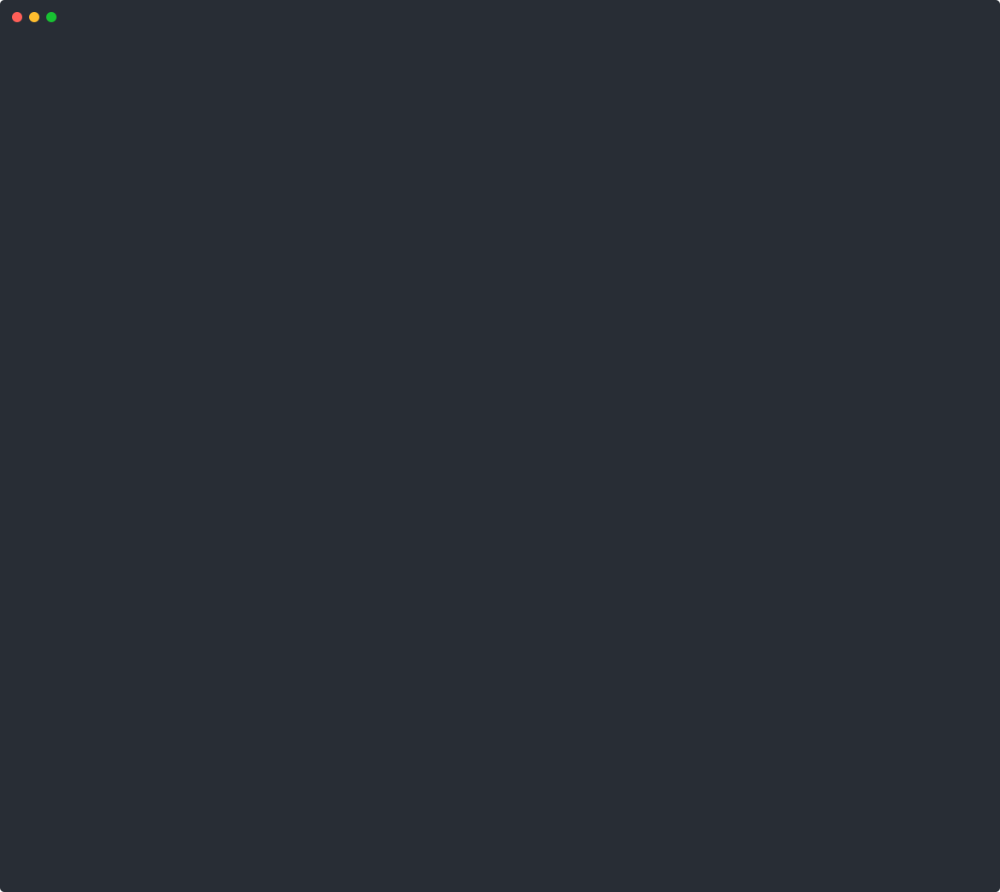
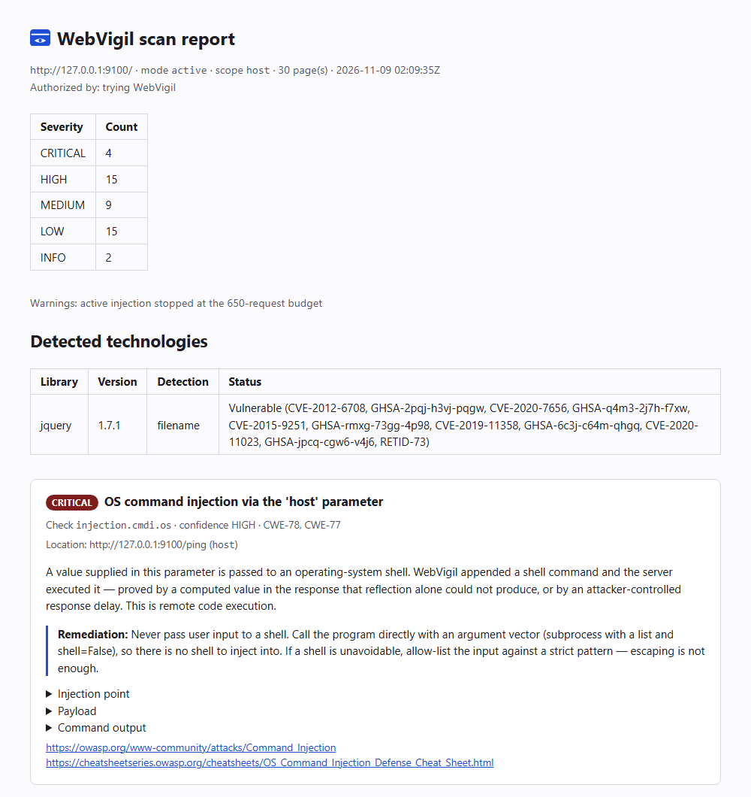
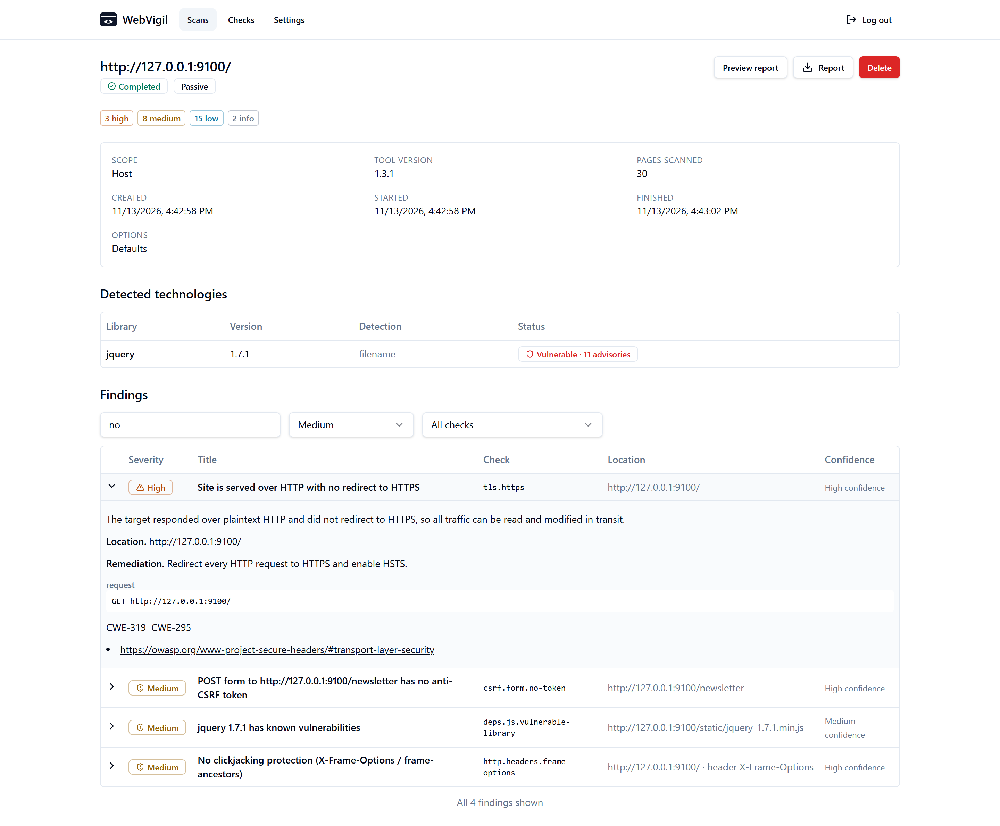

#  WebVigil

[English](README.md) · **Português (Brasil)**


[](https://github.com/ryanvmorais/webvigil/actions/workflows/ci.yml)
[](https://pypi.org/project/webvigil/)
[](https://github.com/ryanvmorais/webvigil/releases)
[](https://github.com/ryanvmorais/webvigil/pkgs/container/webvigil)


**O WebVigil é um scanner de vulnerabilidades em aplicações web (DAST), open source, para desenvolvedores.**
É um engine Python e uma CLI que, por padrão, roda checks passivos e seguros para produção e, só
com uma autorização explícita, um Modo Ativo para XSS refletido e armazenado, SQL injection,
SSRF, injeção de comandos, XXE, upload de arquivos e mais, com cada achado ativo confirmado contra
uma linha de base (baseline). Ele escreve relatórios em JSON, SARIF 2.1.0, HTML e Markdown e
derruba o build com `--fail-on`, então cabe em CI.

Ele ajuda times a encontrar e corrigir problemas de segurança em aplicações web, tanto **em
desenvolvimento** (terminal, CI, pré-deploy) quanto **em produção** (checks não intrusivos, seguros
para rodar em sistemas no ar). O WebVigil vem como um **engine de scan** reutilizável, uma **CLI**
e um **dashboard web** opcional, construído sobre o mesmo engine.

> **Status:** lançado e mantido: [instale](#instalação). A CLI, os códigos de saída, as chaves de configuração, os ids dos checks e o relatório JSON seguem o
> [versionamento semântico](docs/stability.md); o que cada versão mudou está no [changelog](CHANGELOG.md). [Escopo e limitações](#escopo-e-limitações) diz o que o
> WebVigil deliberadamente não faz.

**Site:** [webvigil.ryanmorais.com.br](https://webvigil.ryanmorais.com.br/)



*Uma execução real contra o app de teste que vem junto, mantida na primeira tela por `| head -40`.
O comando é digitado para a gravação e a espera no meio é cortada (o app de teste tem casos
lentos, por tempo, então o scan real leva cerca de um minuto e meio). A origem está em
[`assets/cli-scan-demo.cast`](assets/cli-scan-demo.cast); reproduza com `asciinema play`.*

## WebVigil e outros scanners

| | WebVigil | OWASP ZAP | Nuclei |
|---|---|---|---|
| Distribuição | Biblioteca + CLI + dashboard opcional | Interface gráfica + daemon (Docker/desktop) | CLI + templates YAML |
| Seguro por padrão | Só passivo, a menos que `--mode active` seja explícito | O scan ativo é um fluxo padrão comum | Em geral só leitura, depende do template |
| Achados confirmados | Todo achado ativo é provado contra uma linha de base por requisição | Assinaturas + regras de scan ativo | Casamento de assinatura/template |
| Melhor para | Checks in-band, nativos de CI, na sua própria aplicação | Pentest manual profundo com interface gráfica/proxy | Varreduras rápidas contra milhares de templates de CVE e má configuração conhecidos |
| Licença | Apache-2.0 | Apache-2.0 | MIT |

O WebVigil não substitui nenhum dos dois: use-o junto do [Nuclei](https://github.com/projectdiscovery/nuclei)
para casar templates de CVEs conhecidas, ou do ZAP para testes manuais conduzidos por proxy. Veja
[Escopo e limitações](#escopo-e-limitações) para o limite completo.

---

## O que ele verifica

Os checks passivos rodam por padrão e são seguros para apontar para produção. O Modo Ativo (Active
Mode) acrescenta a injeção de payloads e exige `--mode active` e `--authorized-by`. Uma chave na
última coluna liga algo que fica desligado até você citá-la ([as dez chaves](#as-chaves-que-vêm-desligadas)).
`webvigil list-checks` mostra o id de cada check.

| Área | O que encontra | Modo | Chave |
|---|---|---|---|
| Transporte e cabeçalhos | Cabeçalhos de segurança ausentes, cabeçalhos que revelam tecnologia, flags de cookie, configuração de TLS / HTTPS, má configuração de CORS, Subresource Integrity ausente, conteúdo misto ([docs](docs/content-checks.md)) | Passivo | |
| Bibliotecas | Bibliotecas JavaScript do lado do cliente com vulnerabilidades conhecidas, a partir de uma base Retire.js embutida e, se você quiser, do OSV.dev ([docs](docs/dependency-fingerprinting.md)) | Passivo | `--osv-online` |
| Vazamento de informação | Stack traces, listagem de diretórios, identificador de sessão na URL, IP privado no corpo; `.git`, `.env`, backups e endpoints de debug expostos ([docs](docs/information-disclosure.md)) | Passivo | `--probe` para os arquivos expostos |
| Injeção | XSS refletido, SQL injection (por erro, booleana, por tempo), path traversal, open redirect, injeção de comandos de SO, injeção de template e de linguagem de expressão, injeção de LDAP / XPath / SSI ([docs](docs/active-injection.md)) | Ativo | |
| XSS armazenado | XSS persistente, achado injetando um marcador e rastreando de novo ([docs](docs/active-injection.md#stored-xss----stored-xss-opt-in)) | Ativo | `--stored-xss` |
| SSRF | In-band: serviço de metadados de nuvem, loopback e recursos internos, `file://` ([docs](docs/active-injection.md#ssrf--cloud-metadata-loopback-file)) | Ativo | |
| Envelope da requisição | CRLF / response splitting, injeção de cabeçalho Host, métodos HTTP arriscados, XXE in-band ([docs](docs/active-injection.md#request-envelope-injection)) | Ativo | `--xxe` para o XXE |
| Upload de arquivo | Upload irrestrito: um marcador inofensivo com nome ou tipo perigoso, buscado de volta para provar execução, renderização inline ou uma escrita por path traversal ([docs](docs/active-injection.md#file-upload----file-upload-opt-in)) | Ativo | `--file-upload` |
| CSRF | Um formulário `POST` sem token; um formulário `GET` que muda estado. Com a chave, cada formulário é repetido entre sites e só é relatado se o servidor aceitar ([docs](docs/authenticated-scanning.md#active-csrf-confirmation----confirm-csrf-opt-in)) | Passivo e depois Ativo | `--confirm-csrf` |
| Sessões | Ids de sessão fracos, fixação de sessão, um logout que não invalida a sessão. Os achados nomeiam o cookie e nunca carregam o valor ([docs](docs/authenticated-scanning.md#session-security-checks)) | Passivo e depois Ativo | `--sample-sessions` `--test-logout` |
| Scan autenticado | Um scan atrás de login: um cookie, um cabeçalho ou token bearer ou, no Modo Ativo, um login por formulário que o próprio WebVigil faz ([docs](docs/authenticated-scanning.md)) | Qualquer | `--cookie` `--header` `--login-url` |
| O que é escaneado | O crawl e a passada de injeção alimentados por um schema OpenAPI ([docs](docs/api-scanning.md)) ou por uma gravação HAR, para aplicações de página única ([docs](docs/har-import.md)); no Modo Ativo o crawler também pode enviar formulários `POST` ([docs](docs/authenticated-scanning.md#post-forms----submit-post-forms-opt-in)) | Qualquer | `--openapi` `--har` `--submit-post-forms` |

Como ele se saiu contra o OWASP DVWA (três níveis de segurança), o Juice Shop e o WebGoat, rodados
na máquina do próprio mantenedor, está em [docs/benchmark.md](docs/benchmark.md): o que achou, o
que deixou passar e por quê. É a medição de uma pessoa, ninguém independente a contou, e nenhum
outro scanner foi rodado.

---

## Seguro por padrão

O WebVigil roda em **Modo Seguro** (Safe Mode) por padrão: ele só observa respostas, cabeçalhos,
configuração de TLS, cookies e o conteúdo das páginas. Nunca envia payloads de ataque e é seguro
apontá-lo para produção. A única requisição além dos GETs comuns de página é um GET com um
cabeçalho `Origin`, usado para detectar CORS refletido: continua sendo um GET somente leitura, e
continua restrito ao escopo do alvo.

O **Modo Ativo** (Active Mode, injeção de payloads: XSS, SQLi, SSRF etc.) é opt-in, exige uma
flag de autorização explícita e é pensado só para ambientes de desenvolvimento e de homologação.

### As chaves que vêm desligadas

| Chave | O que faz | Toca o alvo |
|---|---|---|
| `--probe` | Pede caminhos sensíveis: `.git`, `.env`, backups, endpoints de debug | Só lê |
| `--stored-xss` | Injeta um marcador e rastreia de novo para achá-lo | **Escreve** |
| `--file-upload` | Envia um arquivo-marcador inofensivo | **Escreve** |
| `--confirm-csrf` | Envia cada formulário que muda estado e depois o repete entre sites | **Escreve** |
| `--submit-post-forms` | O crawler envia formulários `POST` e as operações `POST` do `--openapi` | **Escreve** |
| `--xxe` | Reescreve corpos `POST` como XML | Envia corpos XML |
| `--osv-online` | Consulta as bibliotecas no `api.osv.dev` | Envia nomes de bibliotecas para fora |
| `--login-url` | Faz login uma vez com a conta que você informar (só no Modo Ativo) | Cria uma sessão |
| `--sample-sessions` | Alguns `GET`s sem cookie da URL de entrada | Só lê |
| `--test-logout` | Encerra a própria sessão do scan (só no Modo Ativo) | Encerra uma sessão |

Todo o resto só lê.

---

## Uso responsável

Um scanner envia requisições a um sistema, então quem pode apontá-lo para onde importa tanto
quanto o que ele encontra.

- **Só alvos autorizados.** Faça scan de sistemas seus ou que você tenha permissão explícita para
  testar. Escanear o sistema de outra pessoa sem permissão pode ser ilegal onde você mora, e
  baixar esta ferramenta não é essa permissão.
- **O Modo Ativo tem uma trava.** Ele exige `--mode active` **e** `--authorized-by "<quem /
  contrato>"`; sem o nome o WebVigil recusa (código de saída `5`), e o nome é escrito no
  relatório.
- **Tudo que escreve, faz login ou fala com o exterior vem desligado**, cada um atrás da sua
  própria chave: `--stored-xss`, `--file-upload`, `--submit-post-forms` e `--confirm-csrf`
  escrevem no alvo; `--login-url` cria uma sessão; `--osv-online` envia nomes de bibliotecas para
  o OSV.dev.
- **Sempre ligado:** uma trava de escopo que mantém toda requisição no host e na porta do alvo (e
  longe de endereços internos quando o alvo é público), um orçamento de
  requisições, um limite de concorrência e um intervalo, e o `robots.txt` é respeitado a menos que
  você o desligue.
- **O que o WebVigil não faz:** força bruta de credenciais, burlar WAF ou IDS, manter acesso,
  tirar dados do alvo ou explorar além de uma prova limitada. Isso não está no roadmap
  ([Escopo e limitações](#escopo-e-limitações)).
- **As demonstrações ficam em alvos seguros.** As capturas de tela, as gravações e os posts deste
  projeto escaneiam o app de teste que vem junto (`scripts/serve-fixture-app.py`) ou os sistemas
  do próprio mantenedor, nunca os de terceiros.

Achou uma vulnerabilidade **no WebVigil**? Relate em particular, veja o [SECURITY.md](SECURITY.md).
Achou uma no sistema de outra pessoa com ele? Avise o dono e siga a política de divulgação dele.

---

## Escopo e limitações

O WebVigil é deliberadamente limitado. É um scanner **in-band**: o engine fala só com o alvo,
envia um conjunto pequeno e estático de payloads e confirma todo achado ativo contra uma linha de
base por requisição. Essa linha o mantém rápido, com pouco ruído e seguro de distribuir como
ferramenta open source sem serviço hospedado, ao custo das classes abaixo. Para cada uma, o que
usar no lugar.

- **Aplicações renderizadas em JavaScript.** O crawler lê HTML; não roda um navegador headless,
  então uma SPA que monta o DOM em JS expõe quase nenhuma superfície ao crawl (o scan avisa
  quando a página de entrada parece ser uma). *Em vez disso:* navegue pela aplicação uma vez com
  o painel de rede aberto, salve o tráfego como um arquivo HAR e passe-o com `--har`
  ([docs](docs/har-import.md)), ou aponte o `--openapi` para o schema da aplicação; qualquer um
  dos dois alimenta direto o crawl e a passada de injeção.

- **Vulnerabilidades cegas / fora de banda.** SSRF cego, injeção de comandos cega, XXE cego /
  OOB, XSS armazenado cego sem marcador refletido e HTTP request smuggling exigem ou um servidor
  colaborador hospedado pelo scanner (domínio público, listeners de DNS/HTTP) ou controle de
  socket bruto sobre o enquadramento da requisição. Os dois cruzam a regra de que "o engine fala
  só com o alvo". *Em vez disso:* use o WebVigil junto do seu próprio colaborador, como o Burp
  Collaborator ou o [interactsh](https://github.com/projectdiscovery/interactsh). Contexto:
  [por que o SSRF cego é a única coisa que o WebVigil não fará](docs/notes/why-not-oast.md).

- **Algumas classes de scan ativo.** Injeção de código por `eval()`, NoSQL injection, HTTP
  parameter pollution, remote file inclusion, DOM XSS e bypass de autenticação por verbo ficam de
  fora: cada uma está adiada, não tem um oráculo in-band confiável ou precisa de um navegador. A
  tabela completa do que é coberto e do que não é, com o motivo de cada um, está em
  [`docs/active-injection.md`](docs/active-injection.md#coverage-boundaries).

- **Autenticação.** O WebVigil se autentica com um cookie (`--cookie`) ou um cabeçalho
  (`--header`) **estáticos** que você fornece ou, no Modo Ativo, faz login sozinho em um
  **formulário** (`--login-url`) e entra de novo quando a sessão cai. Ele não resolve CAPTCHA,
  MFA, fluxos de SSO / OAuth nem login por token JSON. Ele checa a segurança da sessão (ids
  fracos, fixação, um logout que não invalida), mas nunca adivinha um id. *Em vez disso:* faça
  login no navegador e cole o cookie da sessão. Veja o
  [scan autenticado](docs/authenticated-scanning.md).

- **Não é um scanner de templates.** Não há uma base de templates de CVE no estilo do Nuclei,
  nem enumeração de CMS ou plugins, nem casamento de exploits além dos dados Retire.js embutidos e
  da consulta opt-in ao OSV.dev. *Em vez disso:* rode o [Nuclei](https://github.com/projectdiscovery/nuclei)
  ao lado.

- **Não é um fuzzer.** Os payloads são um conjunto pequeno, documentado e dentro do repositório,
  sem motor de mutação nem ajuste para evadir WAF; o WebVigil testa os parâmetros que o alvo de
  fato expõe, não os adivinhados. *Em vez disso:* um fuzzer dedicado (ffuf, wfuzz) para
  descoberta de parâmetros e força bruta.

- **Não é um framework de exploração.** Uma SQLi confirmada é provada com um marcador limitado,
  não despejando o banco; um traversal confirmado lê um arquivo conhecido, não o disco inteiro. O
  WebVigil para na prova.

- **Bordas do scan de APIs.** O `--openapi` lê só **JSON** (converta antes um documento YAML) e
  testa parâmetros de query / path / corpo form-urlencoded, não campos individuais de um corpo de
  requisição JSON. Veja o [scan de APIs](docs/api-scanning.md).

- **Fronteiras de rede.** Um scan de alvo público nunca conecta em endereço de loopback, privado
  ou link-local, nem para um subdomínio no escopo cujo DNS responda com um deles (DNS
  split-horizon); cada nome de host é resolvido uma vez por scan. Por um proxy HTTP definido no
  ambiente, quem resolve os nomes é o proxy, e essa conferência fica com ele. *Em vez disso:*
  escaneie o host interno diretamente, como alvo próprio.

---

## Instalação

Python 3.12 ou mais novo. O pacote tem o engine e a CLI; o dashboard e o app de teste que vem
junto ficam só neste repositório.

```bash
# Instale (ou: uv tool install webvigil, ou: pip install webvigil)
pipx install webvigil

# Confira que ele roda
webvigil version

# ou, sem instalar pacotes Python:
docker run --rm ghcr.io/ryanvmorais/webvigil scan https://your-app.example

# guarde um relatório: com --format ele vai para o stdout, então redirecione no host
docker run --rm ghcr.io/ryanvmorais/webvigil scan https://your-app.example \
  --format html > report.html

# re-renderize um scan salvo: monte a pasta que o guarda
docker run --rm -v "$PWD:/work" ghcr.io/ryanvmorais/webvigil \
  report /work/scan.json --format html > report.html
```

A imagem é construída para `linux/amd64` e `linux/arm64` e leva proveniência de build assinada e
um SBOM (veja [releasing](docs/releasing.md#every-release)). O `webvigil[web]` acrescenta a Web API.

## Início rápido

> Os passos abaixo rodam a partir de um clone deste repositório, porque o app de teste vem com
> ele, e precisam do [uv](https://docs.astral.sh/uv/). `your-app.example` representa **um sistema
> seu ou que você pode testar**: troque. Com o pacote instalado, tire o `uv run`.

Experimente primeiro em um alvo feito para ser atacado, na sua própria máquina: um app de teste
que vem com este repositório, ou o [OWASP Juice Shop](https://github.com/juice-shop/juice-shop)
ou o [DVWA](https://github.com/digininja/DVWA) no `localhost`.

```bash
# Clone o repositório
git clone https://github.com/ryanvmorais/webvigil && cd webvigil

# O app de teste precisa do extra web
uv sync --all-extras

# Um app intencionalmente vulnerável em 127.0.0.1:9100
uv run python scripts/serve-fixture-app.py &

# Faça scan nele no Modo Ativo (cerca de 2 minutos: ele tem casos lentos, por tempo)
uv run webvigil scan http://127.0.0.1:9100 --mode active --authorized-by "trying WebVigil"
```

Depois, no seu próprio app:

```bash
# Um scan passivo, o padrão seguro
uv run webvigil scan https://your-app.example

# O mesmo scan, escrito num relatório HTML
uv run webvigil scan https://your-app.example --format html --output report.html

# Sonda também por .git/.env/backups expostos
uv run webvigil scan https://your-app.example --probe

# Modo Ativo: testes de injeção + SSRF in-band
uv run webvigil scan https://your-app.example --mode active --authorized-by "you / engagement"

# + XSS armazenado (escreve marcadores)
uv run webvigil scan https://your-app.example --mode active --authorized-by me --stored-xss

# + teste de upload de arquivos (escreve arquivos)
uv run webvigil scan https://your-app.example --mode active --authorized-by me --file-upload

# + o crawler envia formulários POST (escreve)
uv run webvigil scan https://your-app.example --mode active --authorized-by me \
  --submit-post-forms

# + confirmação de CSRF (envia formulários)
uv run webvigil scan https://your-app.example --mode active --authorized-by me \
  --cookie "session=<paste>" --confirm-csrf

# Um scan autenticado, com o cookie de sessão do seu navegador
uv run webvigil scan https://your-app.example --cookie "session=<paste from your browser>"

# Faz login sozinho
WEBVIGIL_LOGIN_PASSWORD=... uv run webvigil scan https://your-app.example \
  --mode active --authorized-by me \
  --login-url https://your-app.example/signin --username scanner@example.com

# Também avalia ids de sessão anônimos novos (só GET)
uv run webvigil scan https://your-app.example --sample-sessions

# + teste de logout (encerra a própria sessão do scan)
WEBVIGIL_LOGIN_PASSWORD=... uv run webvigil scan https://your-app.example \
  --mode active --authorized-by me \
  --login-url https://your-app.example/signin --username scanner@example.com \
  --test-logout

# Alimenta o scan com um schema de API
uv run webvigil scan https://your-app.example --openapi ./openapi.json

# Alimenta o scan com uma gravação do navegador (SPAs)
uv run webvigil scan https://your-app.example --har ./traffic.har

# Também confere as bibliotecas no OSV.dev
uv run webvigil scan https://your-app.example --osv-online

# Lista todos os checks
uv run webvigil list-checks

# Re-renderiza um scan salvo, offline
uv run webvigil report report.json --format md
```

Por padrão o scan imprime um resumo no terminal (stderr): uma tabela com a contagem por
severidade e depois uma linha por achado (a gravação no topo desta página).

Com `--format` ele escreve o relatório no stdout (ou em `--output CAMINHO`), então dá para
encadeá-lo com um pipe.

Uso em CI: derrube o build com achados de severidade alta:

```bash
uv run webvigil scan "$TARGET_URL" --format sarif --output results.sarif --fail-on high
```

Códigos de saída: `0` limpo · `3` achados no nível de `--fail-on` ou acima · `4` erro
operacional (alvo inválido, host inalcançável, configuração) · `5` Modo Ativo sem
`--authorized-by`.

Para escanear, a partir da imagem, um alvo na sua própria máquina, acrescente `--network host`
(Linux) ou use `host.docker.internal` como nome do host (Docker Desktop).

### O relatório HTML

`--format html` escreve uma página autocontida, sem script e sem arquivo externo: a contagem por
severidade, as bibliotecas detectadas e cada achado com descrição, correção e evidência
recolhível. Ela segue o esquema claro ou escuro do sistema, então dá para anexá-la a um chamado ou
guardá-la como artefato de CI.

<picture>
  <source media="(prefers-color-scheme: dark)" srcset="https://raw.githubusercontent.com/ryanvmorais/webvigil/main/assets/webvigil-html-scan-report-findings-dark.png">
  
</picture>

*O relatório do mesmo scan em Modo Ativo de acima, na paleta clara e na escura (o topo da página;
os achados continuam abaixo, os críticos primeiro).*

```bash
uv run webvigil scan http://127.0.0.1:9100 --mode active --authorized-by "trying WebVigil" \
  --format html --output report.html
```

---

## Web API

Um serviço FastAPI opcional guarda o histórico de scans em SQLite e os roda pelo mesmo engine. É
de um usuário só e prioriza o uso local.

```bash
# Instale a Web API (ou: uv sync --all-extras)
pip install "webvigil[web]"

# Sirva-a em http://127.0.0.1:8000 (documentação OpenAPI em /docs)
webvigil-web serve
```

O banco é criado e migrado na primeira inicialização; abra `/docs` para criar a conta. Veja
[docs/web-api.md](docs/web-api.md) para configuração, autenticação e backup.

---

## Web UI

Um dashboard em Next.js para a Web API: configuração no primeiro acesso, login, histórico de
scans, formulário de novo scan, detalhe do scan com achados filtráveis, prévia e download do
relatório, o catálogo de checks e uma tela de configurações. É um cliente fino da API: nunca
fala com o engine.



Na página de um scan, os achados aparecem do mais grave para o menos grave, 50 de cada vez. O
botão **Load more** traz os próximos 50, e a linha embaixo da tabela diz quantos do total estão
na tela. A seta no começo de cada linha abre a descrição, a evidência, a correção e as
referências do achado.

Três filtros acima da tabela restringem a lista. Eles rodam no servidor, então valem para todos
os achados do scan, não só para as linhas já carregadas:

- **Search** procura uma palavra no título, na URL ou no nome do parâmetro, do header ou do
  cookie, sem diferenciar maiúsculas: `login`, `/admin` ou `X-Frame-Options`, por exemplo. A
  tabela se atualiza quando você para de digitar.
- **Minimum severity** mantém essa severidade e as acima dela: *Medium* mostra Medium, High e
  Critical.
- **Check** mostra os achados de um check só. A lista traz apenas os checks que acharam algo
  neste scan, cada um com o número de achados.

Os filtros se combinam e ficam no endereço da página, então uma visão filtrada pode ir para os
favoritos.

```bash
# API em :8000 em outro terminal (veja acima); depois:
cd web

# Instale as dependências
pnpm install

# O dashboard em http://localhost:3000
pnpm dev

# ou a pilha inteira em containers
# (o dashboard em http://localhost:3000, publicado só em 127.0.0.1):
docker compose up --build
```

O dashboard chama `/api/*` na mesma origem; o Next repassa isso para a API, então não há CORS
envolvido. Toda página é enviada com uma Content-Security-Policy com nonce e os cabeçalhos de
segurança de costume (ela não pode ser embutida em um frame, e um script só roda se levar o nonce
daquela requisição). Veja [docs/web-ui.md](docs/web-ui.md).

O dashboard vive só neste repositório; ele **não** está no pacote do PyPI. O `pip install
webvigil` entrega o engine e a CLI, e o `webvigil[web]` acrescenta a Web API.

---

## Desenvolvimento

```bash
# Os testes e o mypy precisam do extra web
uv sync --all-extras

# Lint
uv run ruff check .

# Confira a formatação
uv run black --check .

# Confira os tipos
uv run mypy src

# O engine não pode importar Typer/Rich/FastAPI/SQLModel/Alembic/PyJWT/argon2/Uvicorn
uv run lint-imports

# Rode os testes
uv run pytest

# Web UI (em web/):
pnpm install && pnpm lint && pnpm typecheck && pnpm test && pnpm build

# Playwright: configuração → scan → relatório → logout, totalmente offline
pnpm test:e2e
```

Veja [docs/](docs/) para a arquitetura, [a stack e por que cada peça foi escolhida](docs/stack.md)
e um guia para escrever seus próprios checks.

---

## Notas de design

Ensaios curtos sobre o raciocínio por trás de decisões específicas: o *porquê* dos ADRs de uma
spec, escrito à parte. Índice completo em [docs/notes/](docs/notes/).

- [O problema do OAST: por que o SSRF cego é a única coisa que o WebVigil não fará](docs/notes/why-not-oast.md)
- [Disciplina contra falsos positivos em um scanner ativo](docs/notes/false-positive-discipline.md)
- [Detectar XSS armazenado significa escrever dados que você não pode desfazer](docs/notes/stored-xss-markers.md)
- [Manter um engine de segurança honesto com o import-linter](docs/notes/engine-boundaries.md)
- [OSV.dev sem chave de API](docs/notes/osv-without-a-key.md)

---

## Licença

[Apache-2.0](LICENSE)
